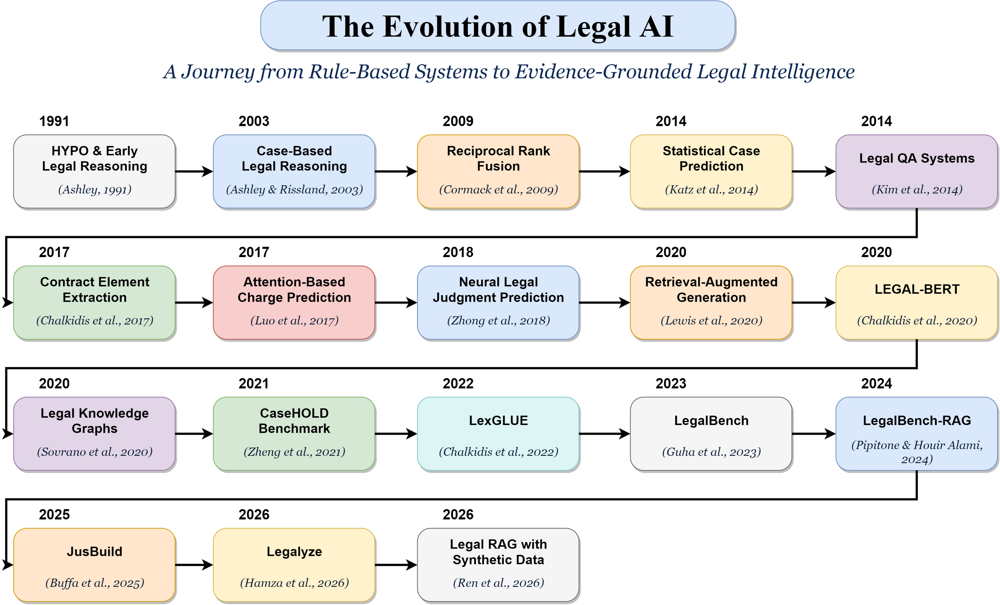
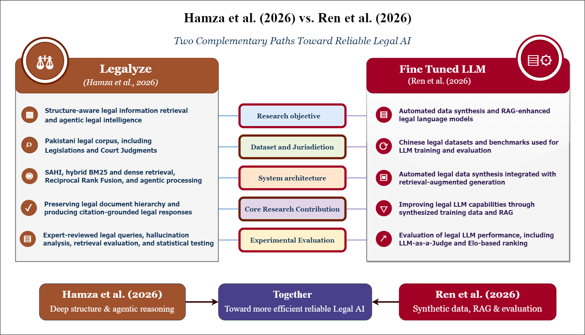
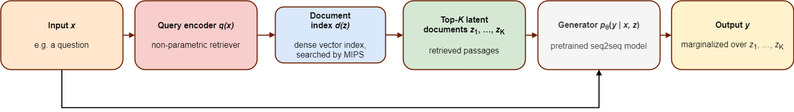

# Legal Artificial Intelligence: From Case-Based Reasoning to Reliable, Structure-Aware Retrieval-Augmented Generation

**A chronological survey of legal AI, from Ashley's HYPO (1991) to Legalyze (2026)**

[](Hamza_et_al_2026_Legal_AI_Survey.pdf)
[](Hamza_et_al_2026_Legal_AI_Survey.tex)
[](references.bib)

---

## Authors

**Ali Hamza** (Corresponding author) · Imran Usman · Rabia Khan

National University of Sciences and Technology (NUST), Islamabad, Pakistan

Contact: ahamza.msse25mcs@student.nust.edu.pk

---

## Abstract

Legal work depends on finding, interpreting, and applying authoritative texts, such as statutes,
regulations, prior decisions, and procedural rules. A useful legal AI system must connect every
claim to a reliable legal source, not just produce fluent language. This survey presents the
development of legal artificial intelligence as one chronological journey, beginning with Ashley's
case-based reasoning system HYPO in 1991 and ending with Legalyze in 2026. We introduce each stage
in the order it was published, moving from early reasoning and prediction through domain-adapted
language models to retrieval-augmented generation and contemporary benchmarks. Legalyze and the
data-synthesis approach of Ren et al. (2026) serve as a comparative case study of two complementary
design philosophies. We bring this account together through three synthesis chapters, covering
reliability and citation verification, jurisdictional and multilingual access with attention to
Pakistan, and open research challenges. Throughout, we restrict every claim to literature we could
independently verify.

**Keywords:** Legal artificial intelligence · Retrieval-augmented generation · Legal information
retrieval · Legal language models · Structure-aware retrieval · Hallucination · Citation
verification · Pakistani legal AI

---

## The Evolution of Legal AI (1991-2026)

<p align="center">
  
</p>

The survey follows the field in the order it actually happened rather than grouping work by theme.
Every milestone shown above is discussed and cited in its corresponding section of the paper.

---

## What this survey covers

| # | Section | Period |
|---|---|---|
| 1 | Introduction | - |
| 2 | Review Methodology | - |
| 3 | Foundations: Case-Based Reasoning and Rule-Based Systems | 1991-2009 |
| 4 | Quantifying and Predicting Legal Outcomes | 2014-2018 |
| 5 | Legal Language Models and Benchmarks | 2020-2023 |
| 6 | The Emergence of Legal Retrieval-Augmented Generation | 2024 |
| 7 | Maturing Legal RAG Systems and Evaluation Research | 2025 |
| 8 | Contemporary Systems and a Comparative Case Study | 2026 |
| 9 | Synthesis: Reliability, Hallucination, and Legal Citation Verification | - |
| 10 | Synthesis: Jurisdiction, Document Structure, and Multilingual Legal AI | - |
| 11 | Open Challenges and Future Research Directions | - |
| 12 | Conclusion | - |

---

## Case study: Legalyze vs. Ren et al. (2026)

Section 8 compares two 2026 systems that target the same reliability problem through different
designs: Legalyze's structure-aware retrieval pipeline and Ren et al.'s synthetic-data training
approach.

<p align="center">
  
</p>

---

## Core architecture: Retrieval-Augmented Generation

Retrieval-augmented generation, introduced by Lewis et al. (2020) outside the legal domain, became
the backbone of legal AI systems from 2024 onward. The figure below reproduces the original
architecture this survey traces into its legal applications.

<p align="center">
  
</p>

---

## Repository structure

```
Q1 Survey Paper - Concise/
├── Hamza_et_al_2026_Legal_AI_Survey.tex   # Main LaTeX file (cas-dc class)
├── Hamza_et_al_2026_Legal_AI_Survey.pdf   # Final compiled paper
├── references.bib                         # Bibliography (251 verified entries)
├── sections/                               # One file per section, 01-12
├── figures/                                 # TikZ-generated figures (.tex)
├── images/                                  # Rasters used in the paper
└── thumbnails/                              # Journal submission assets
```

---

## Building the paper

This paper is written for the Elsevier `cas-dc` class and compiles cleanly on
[Overleaf](https://www.overleaf.com) with no extra setup. To build locally instead:

```bash
latexmk -pdf -interaction=nonstopmode Hamza_et_al_2026_Legal_AI_Survey.tex
```

---

## Citation

If you reference this survey, please cite:

```bibtex
@article{hamza2026legalai,
  title   = {Legal Artificial Intelligence: From Case-Based Reasoning to Reliable,
             Structure-Aware Retrieval-Augmented Generation},
  author  = {Hamza, Ali and Usman, Imran and Khan, Rabia},
  year    = {2026},
  journal = {Preprint},
  note    = {National University of Sciences and Technology (NUST), Islamabad, Pakistan}
}
```

---

## Declaration

The authors used AI for linguistic purposes only, and not for idea generation or creation.

---

## License

All rights reserved by the authors. Contact the corresponding author for reuse or collaboration
inquiries.
